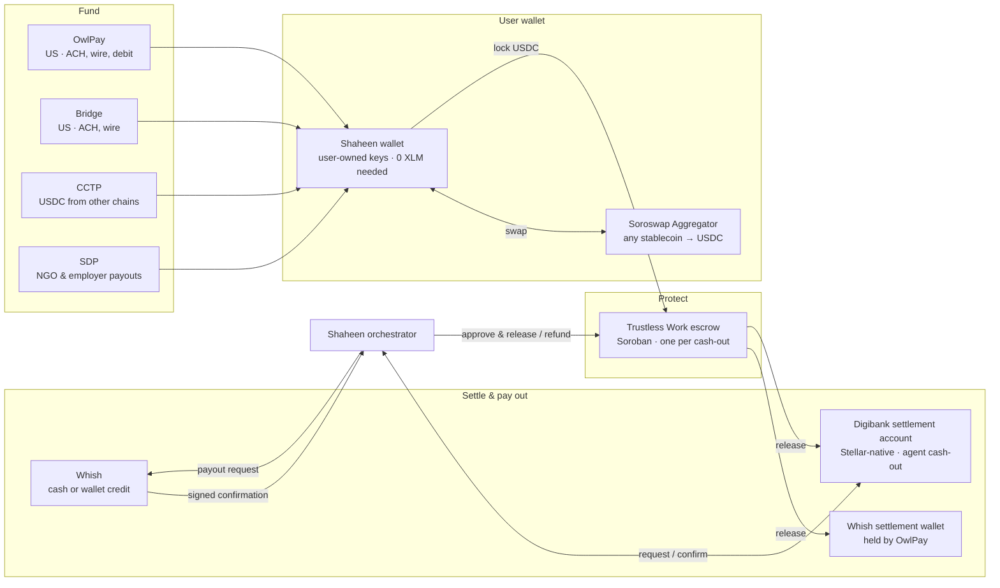
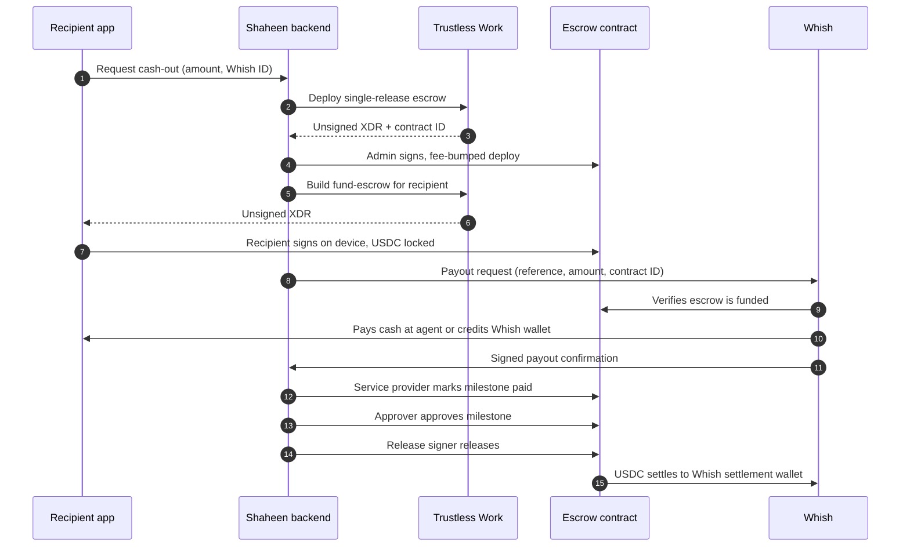
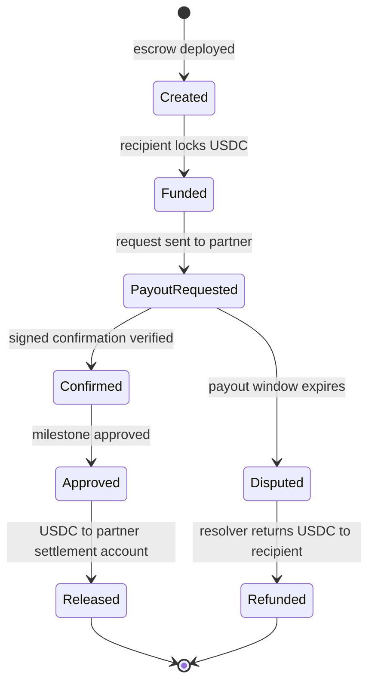
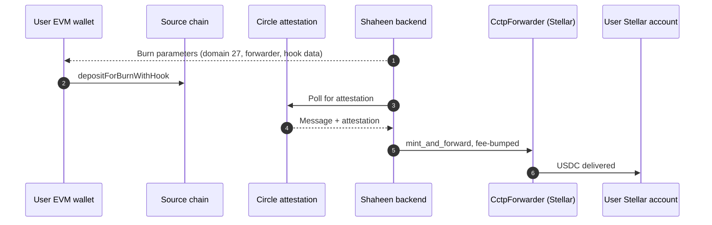

# Shaheen Money — Technical Architecture

**Escrow-backed USDC cash-out to Whish and Digibank in Lebanon and Syria, on Stellar**
SCF #46 · Build Award · Integration Track

| | |
|---|---|
| Stellar building blocks | Trustless Work · Bridge · CCTP · Stellar Disbursement Platform · Soroswap |
| Partners | **OwlPay**: regulated US partner for KYC/KYB, USD ↔ USDC and custody of Whish's settlement wallet · **Whish Money**: licensed payout network in Lebanon (signed LOI) · **Digibank**: Stellar-native cash-out network in Lebanon and Syria |
| Platforms | iOS and Android (React Native) · Node.js backend on the Stellar SDK · Horizon and Stellar RPC |
| Standards | SEP-1 · SEP-10 · SEP-24 · SEP-30 · CAP-15 · CAP-33 · Soroban |

---

## 1. Overview

Shaheen Money is a non-custodial Stellar wallet that moves dollars from the US and abroad to recipients in Lebanon and Syria. This build connects five Stellar building blocks to the live wallet:

- **Trustless Work** escrow protects every cash-out to Whish and Digibank until the payout is confirmed.
- **Bridge** adds a second US on-ramp alongside OwlPay.
- **CCTP** brings native USDC in from other chains.
- **SDP** lets NGOs and employers, starting with Digibank's SDP instance, pay recipients directly into Shaheen.
- **Soroswap** routes every swap to USDC at the best rate across Stellar's DEXs.

**Live today:** non-custodial accounts with SEP-30 recovery, sponsored accounts and fee-bumps, SEP-10/SEP-24 anchor connections, path-payment swaps, and the OwlPay on-ramp and off-ramp.

---

## 2. System architecture

### Components

| Component | Responsibility |
|---|---|
| **Mobile app** | Holds the user's device key in the iOS Keychain / Android Keystore, signs every user transaction on device, renders SEP-24 flows in an in-app browser. |
| **API gateway** | Authenticated app API, partner webhooks (Bridge, Whish, Digibank, OwlPay), rate limiting. |
| **Cash-out orchestrator** | Owns the cash-out state machine: creates escrows, sends Whish and Digibank payout requests, verifies confirmations, approves, releases and refunds. |
| **Ramp service** | Bridge customers and virtual accounts, OwlPay deposits, CCTP attestation polling and minting. |
| **Swap service** | Soroswap quotes and transaction building; falls back to Stellar path payments. |
| **Transaction service** | Builds, simulates and fee-bumps transactions; manages the channel-account pool; submits to Horizon and Stellar RPC. |
| **Signing service** | Holds Shaheen's escrow role keys, sponsor and fee keys in a key management service; each key signs only its permitted operations. |
| **Reconciliation and monitoring** | Ingests ledger and contract events, matches them against partner records, raises alerts. |

---

## 3. Accounts, keys and signing

| Account | Purpose | Control |
|---|---|---|
| **User account** | Holds the user's USDC and other assets | Device key signs (weight 1); master key disabled (weight 0); SEP-30 recovery signers restore access |
| **Sponsor account** | Pays base reserves for user accounts and trustlines (CAP-33) | Key management service; configuration changes need 2-of-3 |
| **Fee account** | Pays every network fee through fee-bumps (CAP-15) | Key management service; auto-topped up from treasury |
| **Channel accounts** | Source accounts for Shaheen-initiated Soroban calls (escrow role actions, CCTP mints), so calls run in parallel without sequence conflicts | Pool managed by the transaction service |
| **Escrow role accounts** | Admin, service provider, approver and release signer for every escrow | One key per role, each in the key management service |
| **Dispute resolver** | Executes refunds | 2-of-3 multisig account, separate from every other role |
| **Platform address** | Trustless Work platform role and fee recipient; registered for attribution | Key management service |

**Signing model.** The backend builds every user transaction, the app signs it on the device, and the transaction service wraps it in a fee-bump before submission. The user's key never leaves the device, and Shaheen can never move user funds.

---

## 4. Escrow-protected cash-out with Whish and Digibank

### 4.1 Escrow configuration

Each cash-out deploys one Trustless Work single-release escrow.

| Field | Value |
|---|---|
| `engagementId` | Shaheen cash-out ID |
| `amount` | Cash-out amount in USDC |
| `trustline` | USDC on Stellar |
| `roles.receiver` | Payout partner's settlement account: Whish settlement wallet or Digibank's Stellar account (allowlisted, fixed at deployment) |
| `roles.serviceProviders` | Shaheen payout key: marks the milestone paid when the partner confirms |
| `roles.approvers` | Shaheen approval key (`approvalsTarget` = 1) |
| `roles.releaseSigners` | Shaheen release key |
| `roles.disputeResolvers` | Shaheen 2-of-3 multisig: executes refunds |
| `roles.platform` | Shaheen platform address |
| `roles.admin` | Shaheen admin key, distinct from all other roles |
| `milestones` | One milestone: "Payout confirmed by partner" |
| `receiverMemo` | Partner settlement reference |

Escrow logic runs on Trustless Work's deployed Soroban contracts; Shaheen adds no custom contracts. Every write call returns unsigned XDR, which the role holder signs and the transaction service submits in a fee-bump.

### 4.2 Cash-out sequence

Digibank cash-outs follow the same sequence, with Digibank in place of Whish and the release landing in Digibank's Stellar account.

### 4.3 Cash-out states

A state advances only after its transaction is confirmed on the ledger.

### 4.4 Refunds

If the payout partner has not confirmed within the agreed payout window, the orchestrator raises a dispute from the service provider key. The dispute blocks the release path. The dispute resolver multisig then resolves with a single distribution to the recipient's account for the full balance. Shaheen credits the Trustless Work protocol fee back to the recipient, so refunds arrive in full.

### 4.5 Whish interface

| Message | Contents | Verification |
|---|---|---|
| **Payout request** (Shaheen → Whish) | Cash-out reference, amount, recipient Whish ID, escrow contract ID | Whish reads the contract and checks it is funded before paying |
| **Payout confirmation** (Whish → Shaheen) | Cash-out reference, status, Whish transaction ID, timestamp | HMAC signature, timestamp window, idempotency on cash-out reference |
| **Daily settlement report** (Shaheen → Whish) | Released escrows, amounts, release transaction hashes | Matches the Whish settlement wallet balance held at OwlPay |

Whish verifies recipients under its own licence and converts settlement USDC to USD through OwlPay.

### 4.6 Digibank interface

| Message | Contents | Verification |
|---|---|---|
| **Cash-out order** (Shaheen → Digibank Cashout API) | Cash-out reference, amount, recipient, chosen agent, escrow contract ID | Digibank reads the contract and checks it is funded before paying |
| **Payout confirmation** (Digibank → Shaheen) | Cash-out reference, status, Digibank transaction ID, timestamp | Signature, timestamp window, idempotency on cash-out reference |
| **Settlement** | Escrow release to Digibank's Stellar settlement account | Verified directly on chain; no off-chain conversion |

Recipients pick a Digibank agent in Lebanon or Syria from Digibank's live location and agent directory, and collect cash there.

---

## 5. Funding

### 5.1 Bridge: second US on-ramp

1. The user completes Bridge KYC through Bridge's hosted flow.
2. Shaheen creates a virtual account with source `usd` and destination `payment_rail: stellar`, `currency: usdc`, `address:` the user's Stellar account.
3. The app shows the user's dedicated ACH and wire details.
4. Bridge converts each deposit and delivers USDC directly to the user's account. Bridge webhooks update the app in real time.

The USDC trustline is sponsored at onboarding, so every deposit lands without the user holding XLM. US users choose Bridge or OwlPay.

### 5.2 OwlPay: primary US on-ramp (live)

OwlPay verifies US senders, takes ACH, wire and debit deposits, and delivers USDC to the user's Stellar account.

### 5.3 CCTP: cross-chain USDC

- `destinationDomain` is `27`; `mintRecipient` and `destinationCaller` are both the `CctpForwarder` contract.
- The hook data carries the user's Stellar address as `forwardRecipient`. Shaheen builds and validates these parameters before the user signs, so a transfer can never be misaddressed.
- The six-decimal message amount is minted as seven-decimal Stellar USDC.
- Shaheen submits the mint from a channel account and pays the fee; minting is idempotent per message, so retries are safe.

### 5.4 SDP: SDP-ready wallet

1. Shaheen publishes `stellar.toml` at `shaheen.money` with its `SIGNING_KEY` for SEP-10 client-domain verification.
2. Shaheen and each SDP operator allowlist each other's domains.
3. A recipient opens the operator's registration link (`asset`, `domain`, `name`, `signature`) through iOS universal links or Android app links.
4. The app checks the domain against the allowlist, fetches the operator's `stellar.toml`, and verifies the signature against its `SIGNING_KEY`.
5. Shaheen sponsors the trustline for the link's asset if the recipient lacks one.
6. The app authenticates with the operator's SEP-10 server using `home_domain` and `client_domain`, then opens the SEP-24 registration in an in-app browser.
7. The recipient completes registration and receives the disbursement directly in Shaheen, ready to cash out through Whish or Digibank. Digibank's SDP instance is the first operator.

---

## 6. Swaps with Soroswap

1. The swap service requests a quote from the Soroswap API for the user's asset (EURC, AUDD or a local stablecoin) into USDC, with a slippage limit.
2. The Soroswap Aggregator routes across Soroswap, Aquarius, Phoenix, Comet and the Stellar DEX in one atomic transaction.
3. The API builds the transaction with the user's account as source; the app signs it on device; Shaheen fee-bumps and submits it.
4. If the price moves beyond the slippage limit, the transaction reverts and the balance is unchanged.

Stellar path payments remain the fallback route.

---

## 7. Fees and sponsorship

| Cost | Paid by | Mechanism |
|---|---|---|
| Account and trustline reserves | Shaheen | CAP-33 sponsorship from the sponsor account |
| Classic transaction fees | Shaheen | CAP-15 fee-bump from the fee account |
| Soroban resource fees (escrow, swaps) | Shaheen | Simulated with Stellar RPC, then fee-bumped |
| CCTP mint | Shaheen | Submitted from a channel account |
| Trustless Work protocol fee (0.3%) | Included in the cash-out fee | Deducted by the escrow contract |

Users never need to hold XLM.

---

## 8. Reconciliation

Every cash-out record carries the cash-out ID, user account, amount, payout partner, escrow contract ID, partner reference, current state and every transaction hash.

| Source | Matched on | Frequency |
|---|---|---|
| Shaheen ledger | Cash-out ID | Real time |
| Escrow contract events | Contract ID | Real time |
| Whish and Digibank confirmations | Cash-out reference | Real time |
| Digibank settlement account | Release transaction hash | Real time (on chain) |
| Whish settlement wallet (OwlPay) | Release transaction hash | Daily |
| Bridge and OwlPay deposits | Deposit ID and Stellar transaction hash | Real time |

Any mismatch raises an alert and holds the affected cash-out until resolved.

---

## 9. Failure handling

| Failure | Behaviour |
|---|---|
| Payout partner does not confirm in time | Dispute raised; full refund to the recipient |
| Duplicate or replayed confirmation | Ignored by idempotency on the cash-out reference |
| Invalid confirmation signature | Rejected and alerted |
| Soroban transaction fails or expires | Rebuilt with fresh simulation and resubmitted; state unchanged until confirmed |
| Trustless Work API rate limit (50 requests per minute) | Requests queued with backoff |
| CCTP attestation pending | Polled until available; mint retried safely |
| Swap price outside slippage | Transaction reverts; new quote offered |
| Bridge deposit delayed | Shown as pending until Bridge delivers |
| Fee or sponsor balance low | Alert and automatic top-up |
| Lost device | SEP-30 recovery restores access |

---

## 10. Security

- Each escrow role has its own key in the key management service and signs only that role's actions.
- The dispute resolver is a 2-of-3 multisig and holds no other role.
- The escrow receiver is allowlisted and fixed at deployment; no key can redirect funds.
- Whish and Digibank confirmations are signed, time-bounded and processed idempotently.
- SDP links are accepted only from allowlisted domains with valid signatures; SEP-24 content is never scraped.
- CCTP parameters are built server-side and validated before the user signs.
- A full STRIDE threat model and on-chain monitoring plan are delivered in Tranche 2 using SDF's templates.

---

## 11. Monitoring

| Alert | Trigger |
|---|---|
| Aged escrow | Funded escrow without confirmation near the payout window |
| Reconciliation mismatch | Any unmatched record |
| Balance threshold | Fee, sponsor or channel account below threshold |
| Failure rate | Transaction or webhook failure rate above baseline |
| Pending ramp | Bridge or CCTP transfer pending beyond expected time |

---

## 12. Delivery

| Tranche | Components |
|---|---|
| **T1 · MVP on testnet** | Bridge on-ramp · CCTP · Trustless Work escrow · Whish payout integration · Soroban fee sponsorship · mobile flows · reconciliation |
| **T2 · Full testnet loop** | SDP-ready wallet · Soroswap routing · Digibank cash-out · mobile flows · failure recovery · threat model and monitoring |
| **T3 · Mainnet launch** | Mainnet deployment · footprint registration · volume reporting · public release |

All components run on testnet against partner sandboxes before mainnet.

---

## 13. Onchain footprint

| Registered address | Attributes |
|---|---|
| Trustless Work platform address | Every Shaheen escrow |
| Whish settlement wallet | Every completed Whish cash-out |
| Digibank settlement account | Every completed Digibank cash-out |
| Sponsor account | Every sponsored user account and trustline |
| Fee account | Every fee-bumped transaction |

Volume is measured from chain data: USDC released from Shaheen escrows to the Whish and Digibank settlement accounts, plus USDC delivered into Shaheen-sponsored accounts through Bridge, CCTP and SDP.
